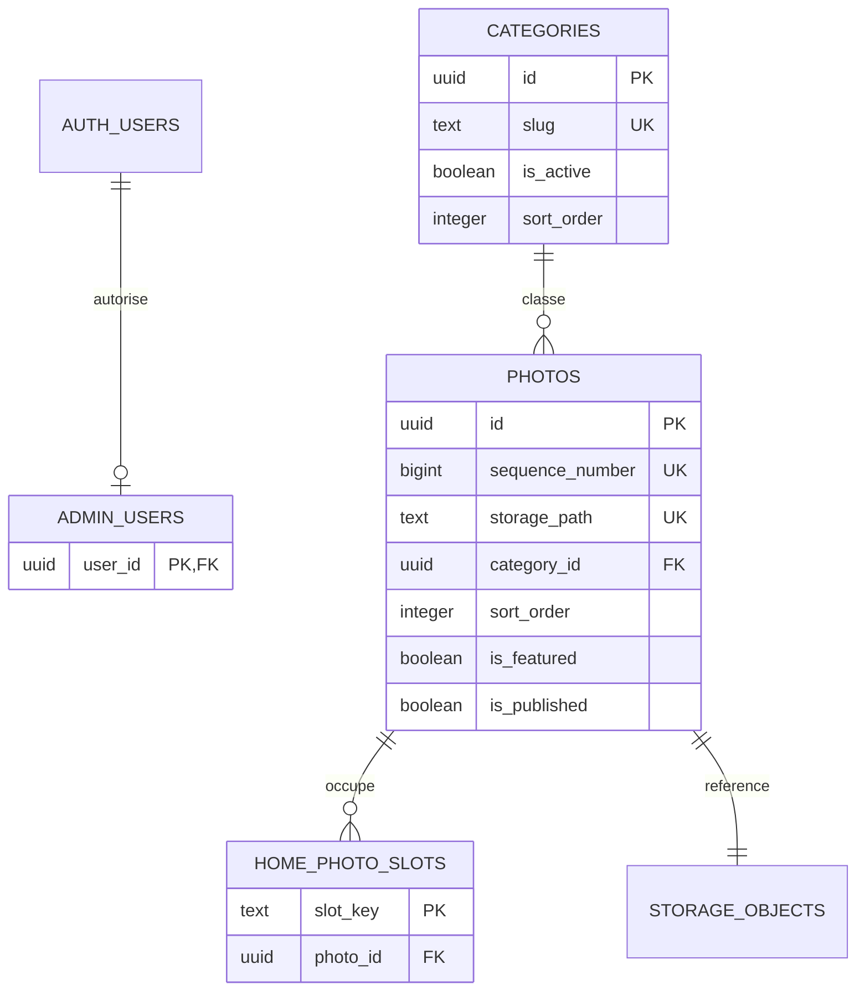

# Portfolio de Pierre Bousquet

Site portfolio professionnel réalisé avec Next.js (App Router), TypeScript strict,
Tailwind CSS et Supabase. Le site public est éditorial et responsive ; l’espace
`/admin` permet à Pierre de gérer ses photographies et les textes publics sans modifier le code.

> État du contenu : le dépôt initial ne contenait aucune photographie originale.
> Les captures Canva jointes ont servi uniquement de référence visuelle et ne sont
> jamais utilisées par le site. Les emplacements restent volontairement sobres
> jusqu’à l’import des fichiers originaux.

> Logo : la signature typographique temporaire **Studio Pierro** doit être remplacée
> par le logo définitif lorsque le fichier source sera fourni. Aucun logo n’a été
> extrait des captures.

## Architecture en un coup d’œil

```mermaid
flowchart LR
  V[Visiteur] --> P[Pages publiques Next.js]
  A[Photographe] --> C[/admin/connexion]
  C --> BO[Back-office Next.js]
  P -->|lecture des contenus publiés| DB[(Supabase PostgreSQL)]
  P -->|URL signées temporaires| ST[(Supabase Storage privé)]
  BO -->|session vérifiée côté serveur| AU[Supabase Auth]
  BO -->|ajout, édition, ordre et emplacements| DB
  BO -->|WebP optimisés| ST
  AU --> AD[admin_users]
  AD -->|autorise les écritures via RLS| DB
```

Le navigateur ne reçoit que la clé publique `anon`. Supabase Auth identifie
l’utilisateur, `admin_users` confirme qu’il s’agit bien de l’administrateur, puis
les politiques RLS décident ce que chaque requête a le droit de lire ou modifier.



Les emplacements de l’accueil sont indépendants de l’ordre des galeries : changer
une image de la bannière ou de la citation ne déplace donc aucune photo dans sa
catégorie.

## 1. Installation

Prérequis : Node.js 22.13 ou supérieur et un projet Supabase.

```bash
npm install
cp .env.example .env.local
npm run dev
```

Le site est alors disponible sur `http://localhost:3000`.

## 2. Commandes disponibles

```bash
npm run dev          # serveur de développement
npm run lint         # analyse ESLint
npm run typecheck    # vérification TypeScript stricte
npm test             # tests automatisés du projet et des règles de sécurité
npm run build        # build de production Next.js
npm run start        # lancement du build de production
npm run test:supabase # scénario d’intégration sur une instance Supabase locale
npm run photos:import -- <dossier> --manifest <manifest.json>
```

## 3. Créer et préparer Supabase

1. Créer un nouveau projet sur Supabase.
2. Dans **SQL Editor**, exécuter dans l’ordre les fichiers du dossier
   `supabase/migrations/` qui ne sont pas encore appliqués. La migration
   `202610120001_site_texts.sql` ajoute les textes éditables aux bases existantes.
3. Vérifier dans **Storage** que le bucket privé `portfolio` existe.
4. Vérifier dans **Table Editor** que les tables `categories`, `photos`,
   `home_photo_slots`, `site_texts` et `admin_users` existent.

La migration crée :

- les trois catégories actives et leurs couleurs ;
- les dix emplacements administrables de la page d’accueil ;
- la séquence globale et non réutilisable des photographies ;
- le bucket privé limité aux WebP de 12 Mo ;
- les index et le déclencheur `updated_at` ;
- toutes les politiques RLS des tables et de Storage.

Avec le CLI Supabase, la même migration peut être appliquée avec :

```bash
supabase link --project-ref VOTRE_REFERENCE
supabase db push
```

## 4. Créer le compte administrateur

Il n’existe aucune inscription publique.

1. Ouvrir **Authentication → Users → Add user** dans Supabase.
2. Créer le compte de Pierre avec son adresse e-mail et un mot de passe fort.
3. Copier l’UUID de cet utilisateur.
4. Exécuter dans SQL Editor, en remplaçant l’UUID :

```sql
insert into public.admin_users (user_id)
values ('UUID_DU_COMPTE_ADMIN');
```

L’accès à `/admin` vérifie la session Supabase et l’appartenance à
`admin_users` côté serveur. Une valeur stockée dans le navigateur ne suffit jamais.

## 5. Variables d’environnement

Copier `.env.example` vers `.env.local`, puis renseigner :

```dotenv
NEXT_PUBLIC_SUPABASE_URL=https://VOTRE-PROJET.supabase.co
NEXT_PUBLIC_SUPABASE_ANON_KEY=VOTRE_CLE_ANON
NEXT_PUBLIC_SITE_URL=https://www.votre-domaine.fr
SUPABASE_SERVICE_ROLE_KEY=VOTRE_CLE_SERVICE_ROLE
```

La clé `anon` est publique par conception ; les politiques RLS assurent la
protection. La clé `service_role` sert uniquement au script local d’import initial :
elle ne doit jamais être préfixée par `NEXT_PUBLIC_`, envoyée au navigateur,
committée ou ajoutée aux variables du site en production.

## 6. Sécurité Supabase

Les règles fournies imposent que :

- un visiteur lise uniquement les lignes `photos.is_published = true` ;
- un visiteur ne puisse jamais insérer, modifier ou supprimer une photo ;
- seul un utilisateur authentifié présent dans `admin_users` puisse écrire ;
- les mêmes restrictions s’appliquent au bucket privé `portfolio` ;
- les images publiques soient servies par des URL signées temporaires ;
- la numérotation provienne d’une séquence PostgreSQL qui ne revient jamais en
  arrière après une suppression.

Contrôles conseillés après la migration :

```sql
select schemaname, tablename, policyname, roles, cmd
from pg_policies
where schemaname in ('public', 'storage')
order by schemaname, tablename, policyname;

select relname, relrowsecurity
from pg_class
where relname in ('categories', 'photos', 'admin_users');
```

Les requêtes d’écriture faites avec la clé `anon` doivent retourner une erreur RLS.

Pour exercer automatiquement l’ajout, la visibilité publique, la modification de
l’ordre, le déplacement, la suppression et la non-réutilisation d’un numéro sur
une instance locale :

```bash
npx supabase start
# recopier les valeurs locales affichées dans .env.local
npm run test:supabase
```

Le script refuse une cible distante par défaut. Pour une base de test distante
jetable uniquement, ajouter explicitement `ALLOW_REMOTE_SUPABASE_TESTS=1`.

## 7. Import initial des photographies

Le script accepte JPEG, PNG et WebP, vérifie le format réel, corrige l’orientation
EXIF, limite le grand côté à 3200 px, produit un WebP de qualité 88, puis enregistre
la largeur, la hauteur et le ratio implicite. Il trie les noms numériquement
(`2.jpg` avant `10.jpg`) et attribue `photo-0001.webp`, `photo-0002.webp`, etc.

Organisation recommandée :

```text
photos-originales/
├── shooting/
├── spectacle-vivant/
└── sport/
```

Copier `scripts/photos-manifest.example.json`, puis fournir pour chaque image un
texte alternatif descriptif. Les chemins du manifeste sont relatifs au dossier
d’import.

```bash
cp scripts/photos-manifest.example.json photos-manifest.json
npm run photos:import -- ./photos-originales --manifest ./photos-manifest.json
```

Pour un dossier contenant une seule catégorie :

```bash
npm run photos:import -- ./portraits --category shooting --manifest ./photos-manifest.json
```

Une image sans texte alternatif est importée **masquée** avec un rappel à
compléter. Elle pourra être décrite puis publiée depuis l’administration. Une
suppression ne libère jamais son numéro.

## 8. Gestion quotidienne des photographies

1. Aller sur `/admin/connexion`.
2. Glisser une ou plusieurs images ou les sélectionner.
3. Choisir la catégorie et saisir un texte alternatif précis pour chaque photo.
4. Ajouter éventuellement une légende et choisir si la photo est immédiatement
   publiée.
5. Cliquer sur **Ajouter les photographies** et suivre la progression.
6. Dans la photothèque, modifier catégorie, texte alternatif, légende, visibilité
   ou couverture.
7. Filtrer une catégorie pour réordonner par glisser-déposer ou avec les boutons
   haut/bas utilisables au clavier.
8. Dans **Page de présentation**, choisir la photographie exacte pour chacun des
   dix emplacements de l’accueil : bannière, portrait, compétences, citation et
   couvertures des trois univers.
9. Utiliser **Prévisualiser le site** avant de terminer.
10. Dans **Modifier les textes**, ouvrir une rubrique, changer le texte voulu,
    puis cliquer sur **Enregistrer**. Les coordonnées modifient aussi les liens
    de contact. La migration des textes doit être appliquée avant cette étape.

Une photographie affectée à un emplacement de l’accueil est automatiquement
retirée des galeries publiques afin d’éviter les doublons. L’option **Image
principale de la page galerie** choisit uniquement la première grande image de la
page de cette catégorie ; les couvertures visibles sur l’accueil se règlent dans
**Page de présentation**.

Les textes alternatifs et les légendes restent modifiables et conservés dans la
base. Les légendes ne sont toutefois pas affichées sur le site public ; les textes
alternatifs restent utilisés par les lecteurs d’écran et lorsque cela est requis
pour l’accessibilité.

La suppression demande une confirmation et retire le fichier de Storage ainsi que
sa ligne de base. L’ordre (`sort_order`) est indépendant du nom physique.

## 9. Déploiement

Le projet est un projet Next.js standard. Sur Vercel :

1. Importer le dépôt Git.
2. Déclarer en production `NEXT_PUBLIC_SUPABASE_URL`,
   `NEXT_PUBLIC_SUPABASE_ANON_KEY` et `NEXT_PUBLIC_SITE_URL`.
3. Ne pas déclarer `SUPABASE_SERVICE_ROLE_KEY` : elle n’est pas nécessaire au site.
4. Déployer, puis renseigner l’URL finale dans Supabase :
   **Authentication → URL Configuration → Site URL**.
5. Lancer un dernier contrôle de `/`, des trois galeries, de `/contact` et de
   `/admin`.

Tout hébergeur compatible Next.js 16 et Node.js 22 peut être utilisé. Le build de
référence est :

```bash
npm run lint
npm run typecheck
npm test
npm run build
```

## 10. Informations attendues du client

- photographies originales, classées ou accompagnées du manifeste d’import ;
- logo définitif dans un format source propre (SVG, PDF vectoriel ou PNG HD) ;
- témoignages clients réels, avec autorisation de publication ;
- adresse professionnelle, SIRET, directeur de publication et hébergeur pour les
  mentions légales ;
- responsable de traitement et durée de conservation pour la politique de
  confidentialité ;
- URL du domaine final ;
- validation finale des textes extraits de la maquette.

## 11. Avis Google

La page `/avis-clients` invite les visiteurs à laisser un avis directement sur
la fiche Google de Studio Pierro. Le bouton principal ouvre le formulaire d’avis
avec le `Place ID` `ChIJ0yDGy0yJ0GUR-lPbukv619k`. Les textes de la page restent modifiables dans
le back-office. Aucun widget ni script tiers n’est chargé par cette page.

Le lecteur Google Business Profile préparé dans `lib/google-business-reviews.ts`
n'est plus appelé par la page, car l'accès API au projet a été refusé. Voir le
[document de la page d’avis](docs/plan-page-avis-google.md).

## Accessibilité et comportement

Le site est prévu pour 390, 768, 1024 et 1440 px, sans défilement horizontal. Le
menu mobile, la lightbox et l’administration sont utilisables au clavier. La
lightbox accepte Échap, les flèches gauche/droite et le balayage tactile. Les
animations respectent `prefers-reduced-motion`. Aucune mesure d’audience, aucun
cookie publicitaire et aucun formulaire de contact non sécurisé ne sont inclus.
