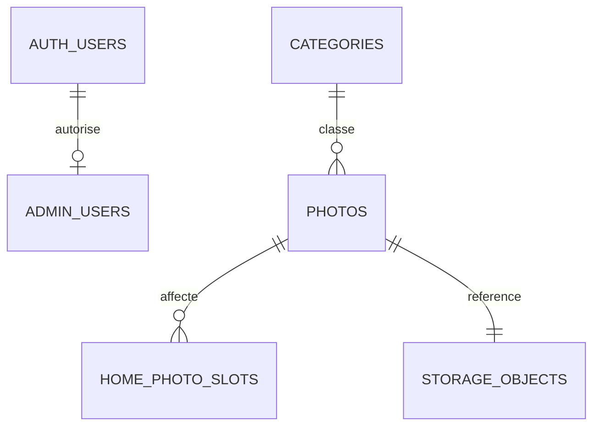

# Documentation du portfolio Pierre Bousquet

> Point d’entrée technique et fonctionnel du projet — état au 12 octobre 2026.
> Les évolutions de l’accueil et de l’édition des textes sont déployées sur Vercel ; la migration Supabase des textes est appliquée. La nouvelle page d’avis Google est encore locale.

## Sommaire

1. [Overview](#overview)
2. [Architecture](#architecture)
3. [Structure du projet](#structure-du-projet)
4. [Pages et parcours](#pages-et-parcours)
5. [Database et sécurité](#database-et-sécurité)
6. [Textes et photographies](#textes-et-photographies)
7. [Code style](#code-style)
8. [Configuration et développement](#configuration-et-développement)
9. [Qualité, SEO et accessibilité](#qualité-seo-et-accessibilité)
10. [Exploitation et état actuel](#exploitation-et-état-actuel)
11. [Références](#références)

## Overview

Ce projet est le portfolio de **Pierre Bousquet**, photographe. Le site présente trois univers — Shooting, Spectacle vivant et Sport — ainsi qu’une page de contact, une page d’avis et les informations juridiques. Un espace d’administration permet de gérer les photographies, leur placement sur l’accueil et les textes publics.

| Sujet | Choix actuel |
| --- | --- |
| Interface et rendu | Next.js 16, App Router, React 19, TypeScript strict |
| Styles | Tailwind CSS 4 via PostCSS et styles du site dans `app/globals.css` |
| Données | Supabase PostgreSQL, Auth et Storage privé |
| Hébergement de production | Vercel, à l’adresse `https://pierrot-photo.vercel.app` |
| Langue du site | Français |
| Version de Node.js | 22.13 ou plus |

La page d’accueil du code local comprend une photo avec parallaxe et une signature « Studio Pierro » qui se réduit et remonte dans l’en-tête pendant le défilement. Les préférences de mouvement réduit sont prises en compte. Les fonds sombres utilisent `#141415`. La signature est temporaire en attendant le logo définitif.

## Architecture

```mermaid
flowchart LR
    Visiteur --> Pages[Pages publiques Next.js]
    Admin[Administrateur] --> Connexion[/admin/connexion]
    Connexion --> Auth[Supabase Auth]
    Auth --> Tableau[/admin]
    Tableau --> API[API /api/admin/*]
    Pages --> Lecture[Lecture serveur]
    Lecture --> DB[(PostgreSQL + RLS)]
    Lecture --> Storage[(Storage privé portfolio)]
    API --> DB
    API --> Storage
    API --> Controle[Contrôle admin_users]
```

Les pages publiques sont des **Server Components** par défaut. Elles chargent les contenus via `lib/`, puis transmettent les données aux composants d’interface. Les composants qui ont besoin du navigateur, comme le tableau de bord, la lightbox ou l’animation de l’accueil, utilisent `"use client"`.

La session Supabase repose sur les cookies. [`proxy.ts`](../proxy.ts) rafraîchit la session sur les requêtes concernées ; [`lib/supabase/server.ts`](../lib/supabase/server.ts) crée le client serveur et `requireAdmin()` vérifie à la fois l’utilisateur connecté et sa présence dans `admin_users`. Chaque route d’écriture refait cette vérification. Les politiques RLS de Supabase restent le dernier contrôle d’accès aux données et au Storage.

### Principaux flux

1. **Page publique :** une route Next.js lit les textes et les photos publiées, crée des URL temporaires pour les images du bucket privé, puis rend la page.
2. **Modification d’un texte :** le back-office envoie une clé et une valeur à `/api/admin/texts` ; la route valide la clé, vérifie l’administrateur, enregistre dans `site_texts` et revalide les pages concernées.
3. **Ajout d’une photo :** le navigateur optimise le fichier en WebP ; l’API vérifie le fichier, attribue un numéro via PostgreSQL, charge le fichier dans Storage et crée la ligne `photos`.
4. **Placement sur l’accueil :** l’administrateur choisit une photo pour un des dix emplacements ; `home_photo_slots` conserve l’affectation indépendamment de l’ordre de la galerie.

## Structure du projet

| Dossier ou fichier | Responsabilité |
| --- | --- |
| [`app/`](../app/) | Pages, layout, métadonnées, sitemap, robots et routes API de l’App Router |
| [`components/`](../components/) | Interface réutilisable : en-tête, pied de page, galeries, administration et animation |
| [`content/site.ts`](../content/site.ts) | Configuration éditoriale et valeurs de texte par défaut |
| [`lib/`](../lib/) | Accès aux données, types, emplacements de l’accueil, validation des images et clients Supabase |
| [`supabase/migrations/`](../supabase/migrations/) | Schéma SQL, fonctions, contraintes, règles RLS et politiques Storage |
| [`scripts/`](../scripts/) | Import initial des photos et test d’intégration Supabase |
| [`tests/`](../tests/) | Vérifications automatisées du projet |
| [`public/`](../public/) | Ressources statiques, notamment le favicon |
| [`docs/`](./) | Documentation complémentaire et captures de contrôle |

L’alias TypeScript `@/` pointe vers la racine du projet. Les types applicatifs principaux sont dans [`lib/types.ts`](../lib/types.ts).

## Pages et parcours

| Route | Fonction | Source principale |
| --- | --- | --- |
| `/` | Accueil, présentation, compétences, univers, contact | [`app/page.tsx`](../app/page.tsx) |
| `/galerie/[slug]` | Galeries Shooting, Spectacle vivant et Sport | [`app/galerie/[slug]/page.tsx`](<../app/galerie/[slug]/page.tsx>) |
| `/avis-clients` | Invitation à laisser un avis sur Google | [`app/avis-clients/page.tsx`](../app/avis-clients/page.tsx) |
| `/contact` | Téléphone, Instagram et courriel | [`app/contact/page.tsx`](../app/contact/page.tsx) |
| `/mentions-legales` et `/politique-confidentialite` | Informations juridiques éditables | [`app/mentions-legales/page.tsx`](../app/mentions-legales/page.tsx), [`app/politique-confidentialite/page.tsx`](../app/politique-confidentialite/page.tsx) |
| `/admin/connexion` et `/admin` | Connexion puis gestion du contenu | [`app/admin/`](../app/admin/) |

Les routes d’administration se trouvent sous [`app/api/admin/`](../app/api/admin/) : photos (`GET`, `POST`, `PATCH`, `DELETE` selon la route), ordre des galeries (`POST`), emplacements de l’accueil (`PATCH`) et textes (`GET`, `PATCH`). Elles ne sont pas des API publiques d’écriture.

## Database et sécurité

### Modèle de données



| Table / ressource | Rôle | Points importants |
| --- | --- | --- |
| `categories` | Univers des galeries | `slug` unique, ordre et état actif ; les trois slugs actifs sont `shooting`, `spectacle-vivant`, `sport` |
| `photos` | Métadonnées des photographies | Catégorie, texte alternatif, légende, dimensions, ordre, publication, couverture de galerie, chemin Storage et numéro unique |
| `home_photo_slots` | Dix positions de l’accueil | Clé d’emplacement et photo affectée ; la suppression d’une photo libère l’emplacement |
| `site_texts` | Textes éditables | Une clé autorisée et une valeur de 1 à 5 000 caractères, avec date de mise à jour |
| `admin_users` | Liste des administrateurs | Référence un utilisateur de Supabase Auth ; aucune inscription publique |
| Bucket `portfolio` | Fichiers WebP | Bucket privé ; accès aux photos publiées selon les politiques Storage et URL signées temporaires |

Les tables SQL emploient des noms de colonnes en `snake_case`. Les pages publiques ne retiennent que les catégories actives et les photos publiées. Les photos placées sur l’accueil sont exclues des galeries publiques. La légende reste stockée pour l’administration mais n’est pas affichée sur les pages publiques ; le texte alternatif alimente l’attribut `alt` des images.

### Migrations

| Fichier | Contenu |
| --- | --- |
| [`202608290001_initial_portfolio.sql`](../supabase/migrations/202608290001_initial_portfolio.sql) | Schéma de départ, catégories, photos, administrateurs, séquence de numérotation, bucket et politiques RLS |
| [`202609150001_home_slots_and_remove_urbain.sql`](../supabase/migrations/202609150001_home_slots_and_remove_urbain.sql) | Emplacements de l’accueil et retrait de l’univers Urbain du site public |
| [`202610120001_site_texts.sql`](../supabase/migrations/202610120001_site_texts.sql) | Table des textes éditables et ses politiques RLS |

Sur une nouvelle base, appliquer uniquement les migrations manquantes **dans cet ordre**. La migration `site_texts` a déjà été appliquée au projet Supabase utilisé par le site. Les politiques autorisent la lecture publique des textes et les modifications par les seuls administrateurs. La clé Supabase `service_role` est réservée au script d’import local ; elle ne doit jamais être exposée au navigateur.

## Textes et photographies

### Textes du site

[`lib/site-texts.ts`](../lib/site-texts.ts) définit les champs disponibles dans le back-office, leurs libellés, leurs groupes et leurs valeurs par défaut. [`lib/get-site-texts.ts`](../lib/get-site-texts.ts) fusionne ces valeurs avec les enregistrements de `site_texts` ; si Supabase est indisponible, les valeurs par défaut restent affichées. Une clé absente de la liste autorisée ne peut pas être enregistrée par l’API.

Les coordonnées et les textes des pages publiques sont administrables. Les **métadonnées SEO**, les données structurées et certaines constantes techniques restent actuellement définies dans le code, par exemple dans [`app/layout.tsx`](../app/layout.tsx) et les métadonnées propres aux pages. Modifier un titre visible dans le back-office ne modifie donc pas automatiquement tous les titres et descriptions destinés aux moteurs de recherche.

### Photographies

- [`lib/home-slots.ts`](../lib/home-slots.ts) décrit les dix emplacements : `hero`, `about`, `skills-1` à `skills-4`, `quote` et les trois couvertures d’univers.
- [`lib/photos.ts`](../lib/photos.ts) charge les images publiées et crée des URL signées d’une heure pour les pages publiques. Sans configuration Supabase, les galeries restent vides et les catégories utilisent leurs libellés de repli.
- Les fichiers ajoutés depuis l’administration sont convertis en WebP côté navigateur, puis revalidés côté serveur. Le bucket limite les WebP à 12 Mo ; le code contrôle aussi les dimensions.
- L’import initial depuis un dossier local se fait avec [`scripts/import-photos.mjs`](../scripts/import-photos.mjs) et un manifeste comme [`photos-manifest.example.json`](../scripts/photos-manifest.example.json). Une image sans texte alternatif est importée masquée, afin d’éviter sa publication sans description.
- La page de galerie ouvre les photographies dans une lightbox utilisable au clavier et sur mobile, via [`components/photo-gallery.tsx`](../components/photo-gallery.tsx).

## Code style

Ces conventions décrivent l’organisation actuelle et servent de guide pour les prochaines modifications :

| Sujet | Convention |
| --- | --- |
| TypeScript | Mode `strict` ; typer les données et les réponses, éviter les valeurs implicites |
| Noms | Fichiers en `kebab-case`, composants et types React en `PascalCase`, fonctions et variables en `camelCase` |
| Imports | Employer `@/` pour les imports internes ; `import type` pour les types seuls |
| React | Garder le rendu et les lectures serveur dans les Server Components ; réserver `"use client"` aux interactions navigateur |
| Répartition | `app/` pour les routes, `components/` pour l’interface, `lib/` pour la logique partagée et l’accès aux données |
| CSS | Styles de page et de composant dans `app/globals.css`, classes lisibles de type `bloc__élément`, variables CSS pour les couleurs et espacements |
| Contenu | Texte visible en français ; ajouter les nouveaux champs éditables dans la liste autorisée avant de les utiliser dans les pages |
| Sécurité | Valider les entrées dans les routes API, appeler `requireAdmin()` pour l’administration et garder les règles RLS en base |
| Accessibilité | Texte alternatif descriptif, liens nommés, navigation clavier, état de focus visible et respect du mouvement réduit |

La configuration effective de ces règles est dans [`tsconfig.json`](../tsconfig.json) et [`eslint.config.mjs`](../eslint.config.mjs). Les contraintes de base doivent compléter les validations TypeScript et API, car le navigateur n’est pas une frontière de confiance.

## Configuration et développement

Depuis la racine du projet :

```bash
npm install
cp .env.example .env.local
npm run dev
```

Renseigner `.env.local` à partir de [`.env.example`](../.env.example) :

| Variable | Usage |
| --- | --- |
| `NEXT_PUBLIC_SUPABASE_URL` | URL du projet Supabase |
| `NEXT_PUBLIC_SUPABASE_ANON_KEY` | Clé publique utilisée avec les politiques RLS |
| `NEXT_PUBLIC_SITE_URL` | URL canonique pour les métadonnées, le sitemap et les liens absolus |
| `SUPABASE_SERVICE_ROLE_KEY` | Facultative ; uniquement pour le script local d’import initial |

Le site local s’ouvre sur `http://localhost:3000`. Sans Supabase configuré, les pages gardent leurs textes par défaut, mais les photographies et la connexion administrateur ne fonctionnent pas.

| Commande | Usage |
| --- | --- |
| `npm run dev` | Développement local |
| `npm run lint` | Analyse ESLint |
| `npm run typecheck` | Vérification TypeScript |
| `npm test` | Tests automatisés du projet |
| `npm run build` | Construction de production Next.js |
| `npm run start` | Démarrage du build |
| `npm run photos:import -- <dossier> --manifest <fichier.json>` | Import initial des photos |
| `npm run test:supabase` | Test d’intégration sur Supabase local |

Le test Supabase crée et supprime des données ; le script refuse une cible distante par défaut. Consulter le [README](../README.md) avant de le lancer. Aucun secret réel ne doit être placé dans les fichiers de documentation ou dans du code destiné au navigateur.

## Qualité, SEO et accessibilité

- [`app/layout.tsx`](../app/layout.tsx) définit les métadonnées globales et les données structurées `ProfessionalService` ; les pages ajoutent leurs propres métadonnées.
- [`app/sitemap.ts`](../app/sitemap.ts) liste les routes publiques ; [`app/robots.ts`](../app/robots.ts) écarte l’administration et ses API de l’indexation.
- Les photos doivent avoir un `alt` décrivant **ce qui est visible et utile à comprendre**. Cela sert aux personnes utilisant un lecteur d’écran et fournit un contexte textuel aux moteurs de recherche ; un texte générique ou répété ne remplit pas ce rôle.
- Les liens « Aller au contenu », les contrôles clavier de la galerie et la réduction des animations sont déjà prévus dans le code. Toute nouvelle interaction doit conserver ces comportements.
- Les liens de contact ouvrent le téléphone, le courriel ou Instagram. Le site public ne comporte pas de formulaire de contact.

## Exploitation et état actuel

La version comprenant les dernières modifications visuelles et l’édition des textes a été déployée sur `https://pierrot-photo.vercel.app` le 12 octobre 2026, après autorisation du propriétaire. La table `site_texts` existe aussi dans Supabase. Les modifications locales ultérieures n’apparaîtront sur le site public qu’après un nouveau déploiement.

`/avis-clients` propose une page éditoriale avec un bouton direct « Laissez un avis » vers la fiche Google Studio Pierro. Les blocs secondaires de haut et de bas ont été retirés à la demande du propriétaire, ainsi que le widget Elfsight, son script et sa section dans la politique de confidentialité. Cette version a été déployée sur `https://pierrot-photo.vercel.app` le 17 novembre 2026. L’accès à l’API Google Business Profile ayant été refusé, le lecteur paginé conservé dans `lib/google-business-reviews.ts` n’est pas utilisé par cette page. Le [document de la page d’avis](./plan-page-avis-google.md) détaille son fonctionnement.

Les mentions légales et la politique de confidentialité sont présentes, mais certains champs de leurs valeurs par défaut restent marqués **« À COMPLÉTER PAR LE CLIENT »**. Ils doivent être renseignés avec les informations réelles avant de considérer le contenu juridique comme final. Les textes alternatifs existants méritent également une revue éditoriale, photo par photo.

## Références

- [README principal](../README.md) : installation détaillée, configuration Supabase et import des photographies.
- [Transmission](../transmission.md) : historique opérationnel et consignes de reprise ; vérifier les dates des informations avant de les utiliser.
- [Page d’avis Google](./plan-page-avis-google.md) : lien direct, contenu et vérifications.
- [Captures de contrôle](./screenshots/) : références visuelles du site.
